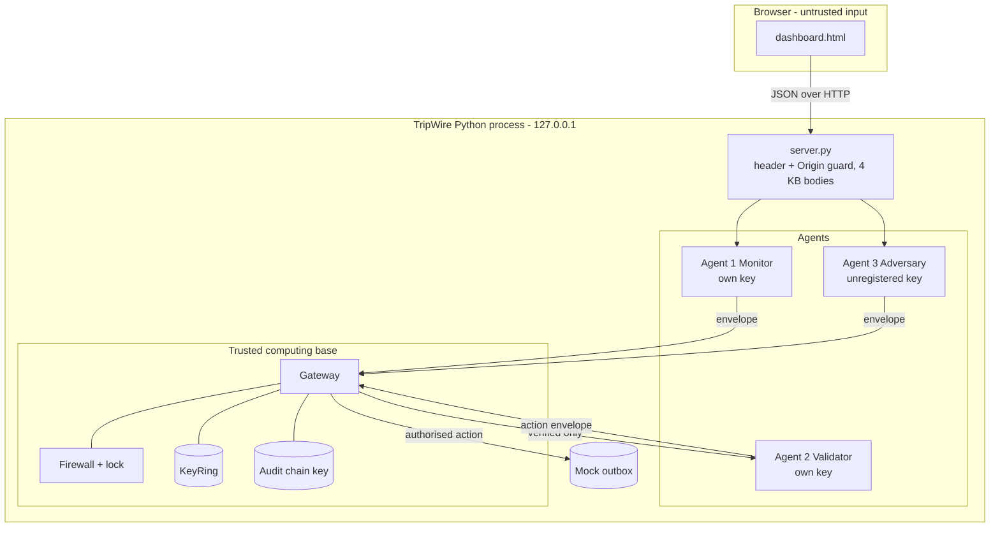
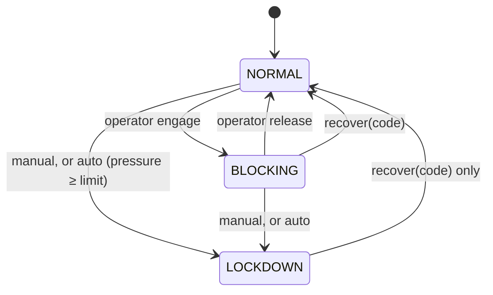

# TripWire Architecture

This document describes the code that is actually in this repository (protocol v2). It is a design guide for a local hackathon demonstration, not a deployment specification.

## 1. Problem and goals

When AI agents exchange messages and trigger actions, the receiving side must decide *at runtime* whether to trust each message and whether to allow the resulting action. TripWire makes that decision explicit, centralised and testable:

- **One enforcement point.** No agent calls another agent or an action directly. Everything goes through `Gateway.submit`.
- **Default deny.** A message is delivered only if every check passes, and each refusal has a stable reason code.
- **Real enforcement.** When the firewall is engaged, protected side effects *cannot* happen. This is proven by tests that inspect the outbox file and the audit order, not UI text.
- **Adversarial pressure.** A built-in attacker uses the same path as the real agents, and the gateway escalates to LOCKDOWN on its own.
- **Evidence.** Every decision, transition and delivery goes into an HMAC-chained audit log.

Out of scope: transport encryption, separate processes or hosts, real email, OS firewall changes, key rotation and storage, user accounts, and attacks on anything outside this process.

## 2. Components

| Module | Responsibility |
|---|---|
| `protocol.py` | Envelope v2 schema, canonical JSON, per-agent `KeyRing`/`Signer`, route table, strict payload schemas |
| `gateway.py` | Validation pipeline, delivery, email action policy, intrusion pressure, audit and outbox recording |
| `firewall.py` | `NORMAL / BLOCKING / LOCKDOWN` state machine, recovery-code check and throttling, shared lock |
| `agents.py` | Agent 1 `EventMonitor` (risk scoring, incident tracking), Agent 2 `Validator` (semantic checks, action request) |
| `attacks.py` | Agent 3 `Adversary` and 10 bounded scenarios |
| `risk.py` | Deterministic risk model and event streams |
| `notifications.py` | `MockEmailService`: records every attempt; only authorised ones reach `outbox.jsonl` |
| `audit.py` | `AuditLog`: HMAC hash chain, `verify()` |
| `session.py` | Wires all of the above; ground-truth metrics; background attack runner; reset |
| `server.py` | Standard-library HTTP API and security headers; serves `dashboard.html` |

## 3. Trust boundaries

The gateway, firewall, key ring and audit key are the trusted computing base. The agents are treated as potentially compromised. The browser is untrusted: every API input is validated on the server, and every value is HTML-escaped on display.

## 4. Message lifecycle (happy path)

1. Agent 1 ingests an event: `score = min(100, 0.8·score + weight[event])`.
2. If `score ≥ threshold` and the open incident has not been alerted yet, it signs an `alert.request` with a new `correlation_id`. Otherwise it signs a `telemetry.report`.
3. The gateway validates the envelope (§5) and delivers it to Agent 2.
4. Agent 2 checks the score against the **server-side** threshold, then signs `action.email.send` with the same correlation id.
5. The gateway validates that envelope too, applies the **action policy** (one email per incident, at most 5 per minute) and calls `MockEmailService.deliver` with server-configured recipients.
6. Every step is written to the audit chain, and Agent 1 marks the incident as delivered.

## 5. Gateway pipeline

The order matters. Each stage raises `ProtocolError(code, detail)`.

| # | Check | Code | Notes |
|---|---|---|---|
| 1 | Canonical JSON size ≤ 4096 B | `SCHEMA_INVALID` / `OVERSIZE` | Before anything else |
| 2 | Firewall state | `FIREWALL_BLOCKING` / `FIREWALL_LOCKDOWN` | Message is then *inspected* to fill `would_fail`; authentic valid ones get burned (§6) |
| 3 | Exact envelope fields and types | `SCHEMA_INVALID` | bool ≠ int, finite timestamps, 32-hex nonce, seq ≥ 1 |
| 4 | `protocol_version == 2` | `UNSUPPORTED_VERSION` | |
| 5 | `message_type` in route table | `UNKNOWN_MESSAGE_TYPE` | |
| 6 | Sender registered | `UNKNOWN_SENDER` | |
| 7 | `alg` and `key_id` match, HMAC verifies | `BAD_MAC` | `hmac.compare_digest` |
| 8 | Sender and receiver match the route | `UNAUTHORIZED_ROUTE` | After MAC, so the code means "authentic but not allowed" |
| 9 | Age ≤ 30 s, skew ≤ 5 s | `STALE` / `FUTURE_TIMESTAMP` | |
| 10 | Nonce and message id unseen | `REPLAY` | |
| 11 | `sequence_number` > last accepted for sender | `SEQUENCE_REGRESSION` | Gaps allowed (lost messages) |
| 12 | Strict payload schema | `PAYLOAD_INVALID` | Exact keys, bounded strings, scores 0-100 |
| 13 | Token bucket (12 burst, 2/s) per sender | `RATE_LIMITED` | After MAC, so forged traffic can't drain a real sender's budget |
| 14 | Receiver semantic check | `VALIDATOR_REFUSED` | e.g. alert below threshold |
| 15 | Action policy | `ACTION_DENIED` | 1 email per correlation id; 5 per 60 s |

Replay, sequence and rate state are **committed only when every check passes**, so rejected messages don't change state. The replay cache is pruned only of entries older than the freshness window; such messages fail at step 9 anyway.

## 6. Firewall state machine

- **What is blocked.** Every agent-to-agent message *and* every protected action. There is no partial mode, so the emergency behaviour is unmistakable.
- **Race freedom.** `Gateway.submit` holds `Firewall.lock` (an `RLock`) from the firewall check through the email side effect, and transitions take the same lock. Test: 8 threads send alerts while an operator thread engages BLOCKING. Every `email.delivered` audit entry precedes the transition, and every later decision is `BLOCKED`.
- **Burning.** An envelope denied by the firewall that *would* have passed every other check has its nonce, id and sequence consumed. Without this, a MITM could capture a blocked alert and replay it after recovery. This was found during browser testing, and a regression test now covers it. Forged envelopes burn nothing.
- **Automatic lockdown.** `pressure = pressure·0.5^(Δt/120s) + severity(code)`. Severity weights range from `SCHEMA_INVALID` 10 and `RATE_LIMITED` 5 up to `BAD_MAC` 40 and `UNAUTHORIZED_ROUTE` 50 (see `gateway.SEVERITY`). The default limit is 200. The full attack sequence crosses it partway through (around the reorder or privilege-escalation scenario, depending on earlier activity).
- **Recovery.** A constant-time comparison against a code printed only on the server console (`TRIPWIRE_RECOVERY_CODE` overrides it). Five failures in five minutes start a 60 s cooldown that even the right code must wait out. Recovery resets the pressure. Demo reset keeps the current mode.
- Every transition is audited with `from`, `to`, `actor`, `reason` and `automatic`.

## 7. Risk scoring

The score is a 0-100 **severity index**, not a probability. Weights: heartbeat 0, config_change 6, failed_login 8, port_scan 12, data_exfil_suspected 25, privilege_escalation 30, malware_signature 35. The decay factor is 0.8 per event.

| Stream | Scores |
|---|---|
| `baseline` | 0 → 8 → 12.4 → 9.92 → 15.94 → 12.75 (never alerts) |
| `incident` | 8 → 14.4 → 23.52 → 48.82 → **74.06 (alert)** → 84.25 |

The dashboard's score slider shows the behaviour below, at and above the threshold. `score == threshold` alerts.

## 8. Adversary threat models

| Model | Capability | Scenarios |
|---|---|---|
| external | Can submit arbitrary bytes; has only its own unregistered key | malformed/oversized, forged sender |
| MITM | Sees legitimate envelopes (channel tap), can hold, modify or re-inject them | tamper, replay, stale, reorder |
| compromised Agent 1 | Has Agent 1's signing key | route escalation, recipient injection, flood, probe while engaged |

What a stolen key *can still do*: send in-policy telemetry and alerts as Agent 1. TripWire limits the blast radius (routes, schemas, rates, one email per incident, server-side recipients, lockdown), but it can't distinguish such messages from real ones. This is stated in the UI footer and the README.

## 9. Audit log

Each entry is `{seq, ts, kind, data, prev, mac}` with `mac = HMAC(audit_key, canonical(entry without mac))` and `prev` = the previous entry's MAC. `verify()` reports the first broken entry for edits, deletions or reordering. The dashboard's *Tamper a record* button edits an old rejected decision in memory (an intruder without the key), and *Verify chain* then pinpoints it. Limitation: whoever holds the in-process key can rebuild the chain, and truncating the tail requires comparing against a previously seen head hash.

## 10. HTTP API

All POST bodies are JSON objects of 4 KB or less. POSTs need `X-TripWire-Client: dashboard`, and a cross-origin `Origin` is refused. Responses carry `state` (the full snapshot).

| Method & path | Body | Effect |
|---|---|---|
| `GET /api/state` | | Full snapshot (never includes keys or the recovery code) |
| `POST /api/stream/step` | `{"stream":"baseline\|incident"}` | Agent 1 ingests the next deterministic event |
| `POST /api/stream/reset` | | Rewind streams, score 0 |
| `POST /api/event` | `{"type":"port_scan"}` | Single event |
| `POST /api/score` (`/api/telemetry`) | `{"score":70}` (legacy `{"value":70}`) | Explicit score report |
| `POST /api/alert` | | Agent 1 explicitly attempts the protected alert |
| `POST /api/threshold` | `{"threshold":1..100}` | |
| `POST /api/firewall` | `{"mode":"NORMAL\|BLOCKING\|LOCKDOWN"}` (legacy `{"enabled":bool}`) | 409 for illegal transitions |
| `POST /api/recover` | `{"code":"..."}` | 409 on a wrong code or cooldown |
| `POST /api/profile` | `{"profile":"strict\|baseline"}` | |
| `POST /api/auto-lockdown` | `{"enabled":bool,"threshold":20..1000}` | |
| `POST /api/attack/<id>` | | Run one scenario synchronously |
| `POST /api/attack-suite` | `{"scenarios":[ids]}` (optional) | Start the bounded background sequence |
| `POST /api/attack/stop` | | Stop the sequence |
| `POST /api/audit/verify` / `tamper` | | |
| `POST /api/reset` | | New session; keeps threshold, profile and **firewall mode** |

## 11. Testing

`python -m unittest discover -t . -s tests -v` runs 54 tests: protocol checks with MAC coverage of each header field; workflow tests for below, at and above the threshold, one email per incident and validator refusal; firewall transitions, throttling, reset-can't-bypass and burning; automatic lockdown and decay; audit tamper and deletion; concurrency (race against BLOCKING, concurrent replay); every attack scenario in both profiles; the bounded and stoppable runner; and the API, including CSRF and input validation. A guided-demo regression test mirrors the dashboard script. CI runs on Ubuntu and Windows with Python 3.10, 3.12 and 3.13.
