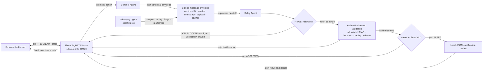

# TripWire Architecture

This document describes the implementation currently in this repository. It is an architecture guide for a local hackathon demonstration, not a deployment specification.

## 1. Problem statement and goals

TripWire demonstrates how a receiving service can decide whether to trust a telemetry message before acting on it. The happy path authenticates a message, checks that it is fresh and unique, validates its payload, applies a threshold rule, and records an alert locally. The adversarial path presents representative failures so a reviewer can observe explicit rejection reasons.

The project aims to make the trust checks and their outcomes visible, testable, and easy to run on a developer's machine. The demo is intended to prove the protocol flow and firewall fail-closed behaviour, not cryptographic novelty or production readiness.

Outside the scope are encrypted transport, remote agents, real email delivery, operating-system firewall configuration, cloud services, persistent replay protection, production key storage, user accounts, and attacks against external systems.

## 2. System architecture

`tripwire/protocol.py` owns signing and envelope checks. `tripwire/agents.py` owns the Sentinel, Relay, and adversarial fixture behaviour. `tripwire/firewall.py` exposes the application-level permit check. `tripwire/notifications.py` appends alert records. `tripwire/__main__.py` assembles the demo, in-memory session, HTTP routes, and CLI. `tripwire/dashboard.html` renders the local console and calls the API. Tests are in `tests/`.

## 3. End-to-end message lifecycle

1. A dashboard request sends a metric and a finite numeric value to `POST /api/telemetry`. The Python API checks the JSON object, metric length (1 to 80 characters), numeric type, and finiteness.
2. Sentinel calls `SignedProtocol.sign("sentinel", payload)`. The envelope contains protocol version, a UUID message ID, sender name, Unix timestamp in seconds, payload, and a hexadecimal signature. The timestamp and ID are envelope fields, not duplicated inside the telemetry payload.
3. The signer serializes the unsigned envelope with sorted object keys, compact separators, UTF-8, and `allow_nan=False`. This canonical representation ensures the signer and verifier compute the MAC over the same bytes regardless of JSON object key order. HMAC-SHA256 authenticates integrity and possession of the shared secret; it does not encrypt the message.
4. The local API passes the envelope directly to Relay in the same process. There is no network connection between agents; HTTP only connects the browser to the local demo service.
5. Relay checks the firewall before protocol verification. With the switch enabled, it returns `BLOCKED` immediately and produces no alert.
6. With the firewall disabled, protocol verification checks envelope type, version, bounded non-empty message ID, allowlisted sender, finite numeric timestamp, object payload, canonicalizability, and HMAC using constant-time comparison. It enforces a default 60-second maximum age and allows up to five seconds of clock skew into the future.
7. Replay protection checks and inserts the message ID under a lock. A repeated ID is rejected. The in-memory set is shared by the demo's Sentinel and Relay protocol object.
8. Relay validates a non-empty metric string and a finite numeric value (booleans are not accepted as numbers). Invalid schema returns `REJECTED` with a reason. Valid values below the threshold return `ACCEPTED`; values greater than or equal to the threshold return `ALERT` and append a JSONL record.
9. The API records the result in a thread-safe in-memory activity feed and returns the updated session state. The browser creates dynamic feed and alert content with text nodes/text content so metric names and result details are not interpreted as HTML.

An authenticated but schema-invalid message consumes its message ID after protocol checks and before Relay's telemetry schema checks. That prevents repeated processing of that same malformed envelope in this session.

## 4. Threat model

### Assets

- Integrity of messages accepted by Relay.
- Correct application of telemetry schema and threshold rules.
- Availability of a fail-closed processing switch.
- Correctness and visibility of the local alert record and dashboard counters.

### Security assumptions and trust boundaries

- Sentinel and Relay are trusted demo components in one Python process and share one HMAC secret.
- The HTTP listener is intended for the same user's machine and binds to `127.0.0.1` by default.
- Dashboard values and HTTP request bodies are untrusted input and are validated server-side.
- Adversary fixtures are controlled inputs generated in-process. They do not open sockets or scan systems.
- The demo secret is public in source and is only useful for demonstrating mechanics. A valid HMAC proves possession of this shared demo key, not the real-world identity of an independent agent.

### In-scope scenarios and expected response

| Scenario | Expected response |
| --- | --- |
| Payload modified after signing | HMAC mismatch; `REJECTED` |
| Previously accepted message sent again | duplicate message ID; `REJECTED` |
| Sender changed to an unauthorized name | sender allowlist failure; `REJECTED` |
| Freshly signed payload with wrong metric/value types | schema failure; `REJECTED` |
| Stale, too-far-future, or non-finite timestamp | freshness/timestamp failure; `REJECTED` |
| Invalid, oversized, or non-object API input | HTTP 400 with a useful error |
| Firewall enabled | `BLOCKED`; no protocol acceptance, counter increment, or notification |
| Valid value at or above threshold | `ALERT`; local JSONL record |

### Out of scope and residual risks

This prototype does not provide confidentiality, network transport security, key secrecy, key rotation, authorization between separate processes, durable replay defence across restarts, rate limiting, authentication for the HTTP API, CSRF protection, TLS, or OS-level packet filtering. The listener can be deliberately rebound with `--host`; do not expose it to a network. The shared secret is hard-coded. Replay state and the dashboard activity feed are memory-only and grow/are bounded only for the feed (100 entries); the protocol replay set is not bounded during a long-running session. The HTTP server is intended for a trusted local demo, not hostile local users or public deployment.

## 5. Agent responsibilities and API design

### Agents and key classes

- **Sentinel (`SentinelAgent`)** accepts a metric and numeric value and returns a signed `Envelope`.
- **Relay (`RelayAgent`)** accepts an envelope and threshold and returns `ReceiveResult`: `ACCEPTED`, `ALERT`, `REJECTED`, or `BLOCKED`, plus a human-readable detail and alert flag.
- **Adversary (`AdversaryAgent`)** transforms an envelope into a tampered payload, replay, forged sender, or malformed fixture. The dashboard's malformed fixture is freshly signed with the demo protocol key so it reaches the schema check; the CLI demo uses this same approach.
- **`SignedProtocol`** signs and verifies envelopes, applies freshness and allowlist checks, and stores seen IDs behind a lock.
- **`DashboardSession`** serializes shared demo state mutations with an `RLock` and keeps counters, latest envelope, event feed, alerts, threshold, and agent objects.

### HTTP API

All routes use the Python standard-library HTTP server. The dashboard is served from `GET /`; no static directory browsing is exposed.

| Method and path | Input | Behaviour |
| --- | --- | --- |
| `GET /api/state` | none | Return current firewall, threshold, counters, feed, and alert items. |
| `POST /api/telemetry` | `{"metric": string, "value": number}` | Validate and send one Sentinel reading through Relay. |
| `POST /api/threshold` | `{"threshold": number}` | Set a finite threshold within the documented API range. |
| `POST /api/firewall` | `{"enabled": boolean}` | Engage or release the application kill switch. |
| `POST /api/attack/tamper` | `{}` | Alter signed value and submit it. |
| `POST /api/attack/replay` | `{}` | Resubmit the most recent telemetry envelope; creates a baseline reading if needed. |
| `POST /api/attack/forged` | `{}` | Change sender to `adversary`. |
| `POST /api/attack/malformed` | `{}` | Submit a validly signed but invalid telemetry schema. |
| `POST /api/attack-suite` | `{}` | Run tamper, replay, forged-sender, and malformed fixtures sequentially. |
| `POST /api/reset` | `{}` | Reset session counters/feed/agents while preserving firewall state and threshold; leave disk files untouched. |

POST request bodies are limited to 4096 bytes and must decode to a JSON object. Unknown routes return 404. Numeric fields reject booleans, non-finite values, and numbers that overflow conversion to a float. The browser refreshes state through the API and sends actions through these POST routes; security checks remain in Python.

## 6. Firewall behaviour

The switch is a `Firewall` object owned by the session. It starts OFF unless `TRIPWIRE_FIREWALL` is set to `1`, `true`, or `on`. A dashboard toggle calls `POST /api/firewall`. When ON, Relay checks `permits()` before signature verification; it returns `BLOCKED`. The API still records the blocked attempt in the activity feed, but does not increase accepted/rejected/alert counters, consume the envelope ID, or write an alert. This makes the switch fail closed for processing. Turning it OFF returns the session to normal message handling. It changes no operating-system firewall rules.

The firewall indicator, Relay status, flow label, event result, and counters show the current state and outcome in the dashboard.

## 7. Data flow and notification handling

Protocol objects, replay IDs, dashboard counters, threshold, feed, and visible alert details live in process memory. The session feed is capped at 100 rows; alert details are capped at 50. Reset replaces agent/protocol state and clears session counters and lists but preserves the chosen threshold and firewall setting.

Each threshold crossing appends a JSON object followed by a newline to the `JsonlOutbox` path. The default path is the system temporary directory as `tripwire-outbox.jsonl`; `TRIPWIRE_OUTBOX` can select a path for both CLI demos and the dashboard server. Each record includes kind, placeholder recipient, subject/body, message ID, and UTC creation time. The recipient `demo-operator@example.invalid` uses the reserved `.invalid` domain so it cannot be a real delivery target. No email provider is configured. Dashboard reset does not delete or truncate this append-only file.

## 8. Failure handling and limitations

- Bad envelope structure, unsupported version, unauthorized sender, invalid canonical content, HMAC mismatch, stale/future timestamp, or replay returns `REJECTED` from Relay.
- Bad metric/value schema or non-finite/overflowing values returns `REJECTED` with a schema reason.
- Invalid HTTP JSON, invalid shapes, numeric range errors, or oversized bodies return HTTP 400; unknown paths return 404.
- A firewall-engaged Relay returns `BLOCKED` before verification and cannot create alerts.
- The API binds to `127.0.0.1` by default. Port conflicts fail at server bind time; choose another local `--port`.
- If the outbox path cannot be written, the write raises an operating-system error. The demo does not include durable queuing or retry semantics; treat the notification as failed and correct the configured path.
- The browser polls the session API; if the server is stopped, it cannot refresh or submit actions. Restart the server and reload the page.

## 9. Design decisions

The project uses the Python standard library to minimize setup friction and keep the code inspectable. A small local HTTP server makes the dashboard interactive without a package manager or cloud service. HMAC-SHA256 is a familiar integrity/authentication mechanism suitable for a shared-secret demonstration, while canonical JSON makes the signed byte sequence explicit. The JSONL outbox makes alert effects inspectable without sending email. In-process attack fixtures keep all adversarial exercises deterministic and confined to the demo. See [`docs/adr/`](docs/adr/) for the current decision records and trade-offs.

## 10. Future improvements

These items are not implemented: move protocol/session/API code into dedicated modules; add durable bounded replay storage; use configurable secret injection and key rotation; add authenticated local sessions and stronger browser/API protections if needed; add explicit outbox error reporting and retry semantics; make alert records and feed pagination more useful for long sessions; add a browser automation check in CI; and design an encrypted authenticated transport before introducing remote agents.
