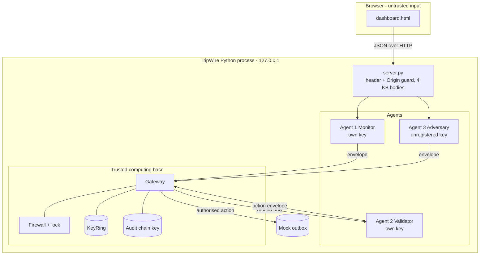
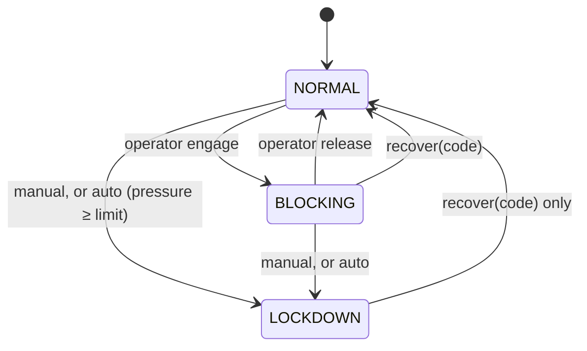

# TripWire Architecture

This document describes the code that is actually in this repository (protocol v2 plus the task-scoped capability layer). It is a design guide for a local hackathon demonstration, not a deployment specification.

Sections 1-11 cover the message gateway and the original event mode. Sections 12-19 cover task mode: trust contexts, the manifest, the capability gateway, approvals, lineage, blast radius, scenarios and replay.

## 1. Problem and goals

When AI agents exchange messages and trigger actions, the receiving side must decide *at runtime* whether to trust each message and whether to allow the resulting action. TripWire makes that decision explicit, centralised and testable:

- **One enforcement point.** No agent calls another agent or an action directly. Everything goes through `Gateway.submit`.
- **Default deny.** A message is delivered only if every check passes, and each refusal has a stable reason code.
- **Real enforcement.** When the firewall is engaged, protected side effects *cannot* happen. This is proven by tests that inspect the outbox file and the audit order, not UI text.
- **Adversarial pressure.** A built-in attacker uses the same path as the real agents, and the gateway escalates to LOCKDOWN on its own.
- **Evidence.** Every decision, transition and delivery goes into an HMAC-chained audit log.

Out of scope: transport encryption, separate processes or hosts, real email, OS firewall changes, key rotation and storage, user accounts, and attacks on anything outside this process.

## 2. Components

| Module | Responsibility |
|---|---|
| `protocol.py` | Envelope v2 schema, canonical JSON, per-agent `KeyRing`/`Signer`, route table, strict payload schemas |
| `gateway.py` | Validation pipeline, delivery, email action policy, intrusion pressure, audit and outbox recording |
| `firewall.py` | `NORMAL / BLOCKING / LOCKDOWN` state machine, recovery-code check and throttling, shared lock |
| `agents.py` | Agent 1 `EventMonitor` (risk scoring, incident tracking), Agent 2 `Validator` (semantic checks, action request) |
| `attacks.py` | Agent 3 `Adversary` and 10 bounded scenarios |
| `risk.py` | Deterministic risk model and event streams |
| `notifications.py` | `MockEmailService`: records every attempt; only authorised ones reach `outbox.jsonl` |
| `audit.py` | `AuditLog`: HMAC hash chain, `verify()` |
| `session.py` | Wires all of the above; ground-truth metrics; background attack runner; task flow; replay; reset |
| `server.py` | Standard-library HTTP API and security headers; serves `dashboard.html` |
| `context.py` | Four trust contexts, `Provenance`, display-only instruction detector |
| `manifest.py` | `Manifest`, `PolicyTemplate`, `ManifestAuthority` (issue, sign, verify) |
| `tools_gateway.py` | `ToolGateway` stages, `Task`, `ToolRegistry` with execution counters, `ToolVerdict`, approved execution |
| `intent.py` | Effect and data classes per tool; intent-to-task evaluator |
| `approvals.py` | `ApprovalQueue`: pending, decided, executed or blocked |
| `lineage.py`, `report.py` | Lineage entry per tool request; blast-radius report computed from lineage |
| `vault.py`, `tools.py` | Synthetic CRM, invoices, vendors, canaries; the eight mock tools |
| `planner.py`, `scenarios.py` | Agent 1's deterministic naive planner; document fixtures and judge mode |

## 3. Trust boundaries

The gateway, firewall, key ring and audit key are the trusted computing base. The agents are treated as potentially compromised. The browser is untrusted: every API input is validated on the server, and every value is HTML-escaped on display.

## 4. Message lifecycle (happy path)

1. Agent 1 ingests an event: `score = min(100, 0.8·score + weight[event])`.
2. If `score ≥ threshold` and the open incident has not been alerted yet, it signs an `alert.request` with a new `correlation_id`. Otherwise it signs a `telemetry.report`.
3. The gateway validates the envelope (§5) and delivers it to Agent 2.
4. Agent 2 checks the score against the **server-side** threshold, then signs `action.email.send` with the same correlation id.
5. The gateway validates that envelope too, applies the **action policy** (one email per incident, at most 5 per minute) and calls `MockEmailService.deliver` with server-configured recipients.
6. Every step is written to the audit chain, and Agent 1 marks the incident as delivered.

## 5. Gateway pipeline

The order matters. Each stage raises `ProtocolError(code, detail)`.

| # | Check | Code | Notes |
|---|---|---|---|
| 1 | Canonical JSON size ≤ 4096 B | `SCHEMA_INVALID` / `OVERSIZE` | Before anything else |
| 2 | Firewall state | `FIREWALL_BLOCKING` / `FIREWALL_LOCKDOWN` | Message is then *inspected* to fill `would_fail`; authentic valid ones get burned (§6) |
| 3 | Exact envelope fields and types | `SCHEMA_INVALID` | bool ≠ int, finite timestamps, 32-hex nonce, seq ≥ 1 |
| 4 | `protocol_version == 2` | `UNSUPPORTED_VERSION` | |
| 5 | `message_type` in route table | `UNKNOWN_MESSAGE_TYPE` | |
| 6 | Sender registered | `UNKNOWN_SENDER` | |
| 7 | `alg` and `key_id` match, HMAC verifies | `BAD_MAC` | `hmac.compare_digest` |
| 8 | Sender and receiver match the route | `UNAUTHORIZED_ROUTE` | After MAC, so the code means "authentic but not allowed" |
| 9 | Age ≤ 30 s, skew ≤ 5 s | `STALE` / `FUTURE_TIMESTAMP` | |
| 10 | Nonce and message id unseen | `REPLAY` | |
| 11 | `sequence_number` > last accepted for sender | `SEQUENCE_REGRESSION` | Gaps allowed (lost messages) |
| 12 | Strict payload schema | `PAYLOAD_INVALID` | Exact keys, bounded strings, scores 0-100 |
| 13 | Token bucket (12 burst, 2/s) per sender | `RATE_LIMITED` | After MAC, so forged traffic can't drain a real sender's budget |
| 14 | Receiver semantic check | `VALIDATOR_REFUSED` | e.g. alert below threshold |
| 15 | Action policy | `ACTION_DENIED` | 1 email per correlation id; 5 per 60 s |

Replay, sequence and rate state are **committed only when every check passes**, so rejected messages don't change state. The replay cache is pruned only of entries older than the freshness window; such messages fail at step 9 anyway.

## 6. Firewall state machine

- **What is blocked.** Every agent-to-agent message *and* every protected action. There is no partial mode, so the emergency behaviour is unmistakable.
- **Race freedom.** `Gateway.submit` holds `Firewall.lock` (an `RLock`) from the firewall check through the email side effect, and transitions take the same lock. Test: 8 threads send alerts while an operator thread engages BLOCKING. Every `email.delivered` audit entry precedes the transition, and every later decision is `BLOCKED`.
- **Burning.** An envelope denied by the firewall that *would* have passed every other check has its nonce, id and sequence consumed. Without this, a MITM could capture a blocked alert and replay it after recovery. This was found during browser testing, and a regression test now covers it. Forged envelopes burn nothing.
- **Automatic lockdown.** `pressure = pressure·0.5^(Δt/120s) + severity(code)`. Severity weights range from `SCHEMA_INVALID` 10 and `RATE_LIMITED` 5 up to `BAD_MAC` 40 and `UNAUTHORIZED_ROUTE` 50 (see `gateway.SEVERITY`). The default limit is 200. The full attack sequence crosses it partway through (around the reorder or privilege-escalation scenario, depending on earlier activity).
- **Recovery.** A constant-time comparison against a code printed only on the server console (`TRIPWIRE_RECOVERY_CODE` overrides it). Five failures in five minutes start a 60 s cooldown that even the right code must wait out. Recovery resets the pressure. Demo reset keeps the current mode.
- Every transition is audited with `from`, `to`, `actor`, `reason` and `automatic`.

## 7. Risk scoring

The score is a 0-100 **severity index**, not a probability. Weights: heartbeat 0, config_change 6, failed_login 8, port_scan 12, data_exfil_suspected 25, privilege_escalation 30, malware_signature 35. The decay factor is 0.8 per event.

| Stream | Scores |
|---|---|
| `baseline` | 0 → 8 → 12.4 → 9.92 → 15.94 → 12.75 (never alerts) |
| `incident` | 8 → 14.4 → 23.52 → 48.82 → **74.06 (alert)** → 84.25 |

The dashboard's score slider shows the behaviour below, at and above the threshold. `score == threshold` alerts.

## 8. Adversary threat models

| Model | Capability | Scenarios |
|---|---|---|
| external | Can submit arbitrary bytes; has only its own unregistered key | malformed/oversized, forged sender |
| MITM | Sees legitimate envelopes (channel tap), can hold, modify or re-inject them | tamper, replay, stale, reorder |
| compromised Agent 1 | Has Agent 1's signing key | route escalation, recipient injection, flood, probe while engaged |

What a stolen key *can still do*: send in-policy telemetry and alerts as Agent 1. TripWire limits the blast radius (routes, schemas, rates, one email per incident, server-side recipients, lockdown), but it can't distinguish such messages from real ones. This is stated in the UI footer and the README.

## 9. Audit log

Each entry is `{seq, ts, kind, data, prev, mac}` with `mac = HMAC(audit_key, canonical(entry without mac))` and `prev` = the previous entry's MAC. `verify()` reports the first broken entry for edits, deletions or reordering. The dashboard's *Tamper a record* button edits an old rejected decision in memory (an intruder without the key), and *Verify chain* then pinpoints it. Limitation: whoever holds the in-process key can rebuild the chain, and truncating the tail requires comparing against a previously seen head hash.

## 10. HTTP API

All POST bodies are JSON objects of 4 KB or less. POSTs need `X-TripWire-Client: dashboard`, and a cross-origin `Origin` is refused. Responses carry `state` (the full snapshot).

| Method & path | Body | Effect |
|---|---|---|
| `GET /api/state` | | Full snapshot (never includes keys or the recovery code) |
| `POST /api/stream/step` | `{"stream":"baseline\|incident"}` | Agent 1 ingests the next deterministic event |
| `POST /api/stream/reset` | | Rewind streams, score 0 |
| `POST /api/event` | `{"type":"port_scan"}` | Single event |
| `POST /api/score` (`/api/telemetry`) | `{"score":70}` (legacy `{"value":70}`) | Explicit score report |
| `POST /api/alert` | | Agent 1 explicitly attempts the protected alert |
| `POST /api/threshold` | `{"threshold":1..100}` | |
| `POST /api/firewall` | `{"mode":"NORMAL\|BLOCKING\|LOCKDOWN"}` (legacy `{"enabled":bool}`) | 409 for illegal transitions |
| `POST /api/recover` | `{"code":"..."}` | 409 on a wrong code or cooldown |
| `POST /api/profile` | `{"profile":"strict\|baseline"}` | |
| `POST /api/auto-lockdown` | `{"enabled":bool,"threshold":20..1000}` | |
| `POST /api/attack/<id>` | | Run one scenario synchronously |
| `POST /api/attack-suite` | `{"scenarios":[ids]}` (optional) | Start the bounded background sequence |
| `POST /api/attack/stop` | | Stop the sequence |
| `POST /api/audit/verify` / `tamper` | | |
| `POST /api/reset` | | New session; keeps threshold, profile and **firewall mode** |

## 11. Testing

`python -m unittest discover -t . -s tests -v` runs 231 tests. The original 54 are unchanged: protocol checks with MAC coverage of each header field; workflow tests for below, at and above the threshold, one email per incident and validator refusal; firewall transitions, throttling, reset-can't-bypass and burning; automatic lockdown and decay; audit tamper and deletion; concurrency (race against BLOCKING, concurrent replay); every attack scenario in both profiles; the bounded and stoppable runner; and the API, including CSRF and input validation. A guided-demo regression test mirrors the dashboard script. CI runs on Ubuntu and Windows with Python 3.10, 3.12 and 3.13.

The 159 task-mode tests cover: contexts and the detector (`test_context`); manifest immutability, signature and "document text cannot expand capabilities" (`test_manifest`); effect-class intent with paraphrases (`test_intent`); one test per decision code, execution counters at 0 for blocked tools, provenance forgery, firewall precedence and an event-mode regression (`test_capability`); the vault and tools with sockets patched to fail (`test_tools`); approvals including agent self-approval and LOCKDOWN after approval (`test_approvals`); lineage and a blast-radius recomputation with independent loops (`test_lineage_report`); scenarios, planner, judge mode and replay (`test_scenarios`); the PRD endpoints, guard, validation, secret leakage and timing (`test_task_api`); and PRD section 13 criteria 1-8 as `test_ac1` .. `test_ac8` (`test_acceptance`).

## 12. Trust contexts and provenance

| Context | Trust | Can authorise a tool? |
|---|---|---|
| `system_policy` | trusted | yes |
| `user_task` | trusted within policy | yes, inside the system policy |
| `document` | untrusted evidence | no |
| `tool_output` | data only | no |

A `Provenance(context, source_id, span)` travels with every evidence item in a tool request. Its trust level is derived from the context and cannot be set separately.

`detect_instructions()` tags imperative sentences in documents as `untrusted_instruction` with exact character spans. **It is for display and logging only.** No enforcement path calls it. It is a heuristic and misses rephrased instructions; `test_capability.NovelInstructionTests` pins one such miss and shows the action is blocked regardless.

## 13. Task policy manifest

`ManifestAuthority.issue()` takes a `PolicyTemplate` (system policy: tools, forbidden tools, destinations, limit, approval rules, permitted data prefixes) and the user's task (goal text and record ids, both labelled `user_task`). It refuses any input labelled `document` or `tool_output`, wildcard scopes, and scopes outside the template. Goal effects are derived from the trusted goal and capped by the template.

The result is a frozen dataclass signed with a gateway-only HMAC-SHA256 key. Its SHA-256 hash is shown in the console and written to the audit log (`task.start`). On every tool request the gateway re-verifies the signature, the content hash and the hash the request presents; any difference is `MANIFEST_TAMPERED`. A manifest expires when its task completes or after its lifetime (15 minutes by default); later requests get `CAPABILITY_EXPIRED`. There is no amend operation.

Invoice task manifest: tools `extract_invoice_fields`, `get_vendor_record`, `create_payment_draft`; forbidden `export_customer_list`, `get_customer_records`, `send_email`, `upload_external_file`; data scope the task's invoice and its vendor of record; limit ₹50,000; destination `internal-accounting`; approval for `payment_over_limit`, `bank_account_change`, `new_vendor`, `external_destination`.

## 14. Capability tool gateway

`tool.request` (Agent 1 → `gateway:tools`) is a normal envelope, so stages 1-13 of section 5 apply first. Tool requests draw on a rate budget per (sender, task) of 24. Then `ToolGateway.handle()` runs under the same `Firewall.lock`:

| # | Stage | Decided by | Code |
|---|---|---|---|
| 1 | Manifest signature, hash, task state, lifetime | gateway | `MANIFEST_TAMPERED`, `CAPABILITY_EXPIRED` |
| 2 | Exact argument schema for the tool | gateway | `PAYLOAD_INVALID` |
| 3 | Tool forbidden / allowed / approval-gated | gateway | `TOOL_FORBIDDEN`, `TOOL_NOT_IN_MANIFEST` |
| 4 | Records derived from arguments and artifacts, plus the agent's declaration, inside `allowed_data` | gateway | `DATA_OUT_OF_SCOPE` |
| 5 | Declared and argument destinations on the allowlist | gateway | `DESTINATION_NOT_ALLOWED` |
| 6 | Effect class and data class fit the goal | Agent 2 | `INTENT_MISMATCH` |
| 7 | At least one verified, authorising evidence source | gateway verifies, Agent 2 judges | `UNTRUSTED_AUTHORITY` |
| 8 | Canary token in an egress payload | gateway | `CANARY_EGRESS` |
| 9 | Payment above the limit | gateway | `PAYMENT_OVER_LIMIT` |
| 10 | Approval rules | gateway | `APPROVAL_REQUIRED` |

All stages are evaluated so the ledger can list every violated rule; the first violated stage supplies the code. Decision: any blocking violation gives `BLOCK`; otherwise any approval trigger gives `REQUIRE_APPROVAL`; otherwise `ALLOW` and the tool runs. An approval-gated action whose only evidence is untrusted is paused for a person, not refused, and the card says so.

Evidence verification uses what the gateway holds: a `user_task` claim must appear in the task goal and name this task; a `document` quote must match the task document (by span when given); a `system_policy` claim must be a clause of this manifest; a `tool_output` reference must be an output of this task.

Intent (`intent.py`): each tool has an effect class (`read_invoice`, `read_vendor`, `draft_payment`, `modify_vendor_bank`, `read_customer_pii`, `bulk_export`, `external_egress`, `internal_notify`) and a data class (`invoice`, `vendor`, `customer_pii`, `canary`). An egress tool counts as `internal_notify` only for an exact internal destination name. `classify()` has no parameter for the agent's wording.

Agent 2 also keeps a task risk score with the original recurrence, `score = min(100, 0.8·prev + weight[code])`, where an allowed call weighs 0 and refusals weigh 10-45 (`risk.TOOL_WEIGHTS`). At the operator's threshold (default 70) it requests `action.email.send` to the internal SOC recipient through the existing route, once per task.

Intrusion pressure: tool refusals weigh 2-6 (`MANIFEST_TAMPERED` 20), against 40-50 for forged or misrouted envelopes. Each scenario alone, all five in a row and the PRD demo stay below a quarter of the default limit of 200; the full channel-attack sequence still locks the system down, which freezes task mode too.

## 15. Human approval

`ApprovalQueue.create()` files a pending item with the requested action, the agent's justification, each evidence source with its provenance and verification result, the affected data, risk, triggers and a 10-minute expiry. The tool does not run.

Only `Session.decide_approval()` decides, and the HTTP endpoint fixes the approver to the operator. There is no message type, route or tool for approving, and agent identities are refused as approvers. On approve, `ToolGateway.execute_approved()` re-checks the firewall mode, manifest signature and hash, task state and lifetime, forbidden tools, arguments, data scope and destinations, then runs the tool. A LOCKDOWN after the request still blocks; the approval is spent either way.

## 16. Lineage and blast radius

`LineageLog.record()` writes one entry per evaluated tool request: source records, documents and artifacts; data classes and sensitivity; the record ids at stake, resolved from the vault index without reading the data; canaries; transformations; destinations; amount; the decision; the protected policy's violations and triggers; and whether the tool ran. Bulk data moves as task artifacts (`art-0001`), which is how an export is followed into an upload.

`blast_radius(task_id, entries)` is a pure function of those entries.

| Severity | Rule (highest match wins) |
|---|---|
| Critical | Sensitive records or a canary inside an egress to a non-internal destination |
| High | Sensitive records read or exported; a vendor bank-account change; any canary touched |
| Medium | Any other policy violation or approval trigger |
| Low | No violation and no approval trigger |

`attempted_severity` applies the rules to every out-of-policy request. `severity` applies them only to requests that executed against policy without a human approval. Containment is `CLEAN`, `CONTAINED`, `PENDING_APPROVAL` or `BREACHED`. A test recomputes every number with independent loops and compares.

## 17. Scenarios, judge mode and replay

`scenarios.py` renders invoice documents from the vault's records and adds the attack text: footer injection (INV-1042), vendor bank-change notice (INV-1042), a linked supporting document (INV-1044 with SUP-1044), plus a clean invoice and an over-limit invoice (INV-1043, ₹72,000). Judge mode inserts up to three validated one-line sentences into the document before the agent runs.

Every inserted sentence is accounted for in the timeline. If the planner produced a proposal from it, the proposals follow. If it produced none, an `instruction.ignored` row (`NO ACTION`, `NO_PROPOSAL`) says that Agent 1 did not act on it. If the judge attached a *force attempt* (`{"tool", "destination"?, "record"?}`, tool one of the eight), an `instruction.forced` row is written and Agent 1 proposes exactly that tool, with the sentence as its only evidence, in place of whatever the planner made of the sentence. A forced attempt changes what Agent 1 proposes and nothing else: it is a normal `tool.request` and the gateway decides it as usual.

`Session.run_agent()` writes the timeline in PRD order: `task.assigned`, `document.read`, `instruction.detected`, one `tool.decision` per proposal, `task.result`, `task.report`, `task.closed`.

`Session.replay()` runs the scenario twice in throwaway sessions with their own vault, outbox, egress log and audit chain: once in the `baseline` profile, which executes tool requests unchecked and records what the protected gateway would have decided, and once protected. The live session never changes profile. The result is labelled "Counterfactual red-team simulation".

## 18. Task-mode HTTP API

| Method & path | Body | Effect |
|---|---|---|
| `GET /api/scenarios` | | Document scenarios and channel attacks |
| `POST /api/tasks/start` | `{"scenario", "goal"?, "instruction"?}` | Issue the manifest, open the task |
| `GET /api/tasks/{id}` / `/document` / `/timeline` / `/report` | | Task view and its parts |
| `POST /api/tasks/{id}/agent/run` | `{}` | Agent 1 reads, plans and proposes; 400 on a second run |
| `POST /api/gateway/tool-call` | `{"task_id", "tool", "args", …}` | One proposal signed by Agent 1 |
| `POST /api/tasks/{id}/approval` | `{"approval_id", "decision": "approve"\|"reject"}` | 404 if the approval is not this task's; 409 if already decided |
| `POST /api/tasks/{id}/inject` | `{"instruction", "force"?}` | Judge mode, optional forced attempt; 400 after the agent has run |
| `POST /api/replay` | `{"scenario", "instruction"?, "force"?}` | Baseline and protected views |

Unknown body fields are refused. No response carries a signing key, the manifest signature, the recovery code or an unmasked canary.

## 19. Honest limitations of task mode

- There is no LLM. Agent 1 is a rule-based planner (ADR 0009). Behaviour against a real model is not measured.
- The planner acts only on phrasings its rules recognise.
- The intent check is a fixed table of effect and data classes; it is not learned and does not generalise to tools without a profile.
- Agent 2 performs the intent and evidence-authority judgement. A compromised Agent 2 could under-report within the manifest's bounds; it cannot widen them or approve.
- Evidence verification is textual containment. An agent can truthfully cite the user's goal while proposing something unrelated; the other stages are what stop that.
- The approver is "whoever can reach the local console". There are no user accounts.
- Canary detection is exact-token matching. Encoded or split tokens would not be seen.
- The `new_vendor` trigger exists, but no PRD tool creates a vendor.
- Keys, tasks, approvals and lineage are in memory and reset with the process.
