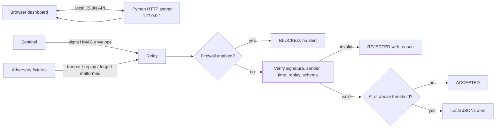

# TripWire — Three-Agent Secure Communication Demo

A local-first defensive-security hackathon demo: two trusted agents exchange authenticated messages and trigger an alert when a threshold is crossed, while a third agent simulates attacks against the protocol. A fail-closed firewall switch blocks processing and notifications.

TripWire makes a common trust problem visible: telemetry must be authenticated and validated before a receiver acts on it. It demonstrates signed messages, freshness and replay checks, threshold decisions, and an observable fail-closed switch. Start with the [architecture guide](ARCHITECTURE.md) for protocol and threat-model details.

## Features

- **Sentinel (Agent A):** creates telemetry events.
- **Relay (Agent B):** verifies signatures, timestamps, sender identity, payload shape, and replay protection.
- **Adversary (Agent C):** simulates tampering, replay, malformed payloads, and forged-sender cases entirely in-process.
- **Firewall kill switch:** blocks message processing while engaged.
- **Local notification outbox:** logs threshold alerts as JSON Lines; it does not send real email.

> This is an application-level simulation, not an operating-system firewall or production security product. The adversary does not scan networks or send external traffic.

## Architecture at a glance



Agents call each other in-process; the browser talks to the Python server over HTTP on loopback. The API routes dashboard actions through the same Python protocol and Relay implementation used by the tests.

## Technology stack

- Python 3.10+ standard library: `http.server`, `hmac`, `hashlib`, `json`, `unittest`.
- Plain HTML, CSS, and JavaScript for the dashboard; no frontend build step.
- GitHub Actions on Python 3.10, 3.11, and 3.12.
- No external runtime packages, cloud services, API keys, or real email integration.

## Prerequisites

Windows 10/11, PowerShell, and Python 3.10 or newer. The project uses only the Python standard library; no Docker, API keys, or third-party packages are required.

## Launch the dashboard

In Windows PowerShell, enter the repository and confirm Python:

```powershell
Set-Location -LiteralPath 'C:\Users\MOUSHIMI\tripwire_in\tripwire_in\trip-wiree'
python --version
```

No dependency installation is required. Run the dashboard:

```powershell
python -m tripwire serve
```

Open **http://127.0.0.1:8765** in your browser. Leave the PowerShell window open while using the dashboard; press `Ctrl+C` to stop the server. The server binds to `127.0.0.1` by default. To choose another local port, use `python -m tripwire serve --port 9000`. Avoid `--host 0.0.0.0`; this is a local demonstration server.

Optional environment variables: `TRIPWIRE_THRESHOLD` (default `75`), `TRIPWIRE_FIREWALL=on` to start with the firewall engaged, and `TRIPWIRE_OUTBOX` to choose the outbox path.

## Guided hackathon demo

1. Start the server and open the dashboard. Point out the three agents and the application firewall status.
2. Send `risk_score = 42` to show a signed, accepted Sentinel → Relay message.
3. Send `risk_score = 90` to cross the default threshold and show the local alert notification.
4. Run **Replay message**, **Tamper payload**, **Forge sender**, and **Malformed schema** individually. Read the rejection reason in the activity feed.
5. Switch the application firewall ON and send another reading. The message should show **BLOCKED** and the alert count should not change. Switch it OFF to resume processing.
6. Use **Run complete attack suite** to replay all four adversarial fixtures, then **Reset demo** to clear the in-memory counters and feed.

## Run the tests

```powershell
python -m unittest discover -s tests -v
```

The suite covers signatures, replay, sender authorization, schema and timestamp validation, threshold alerts, firewall blocking, concurrent duplicate delivery, and dashboard HTTP endpoints.

The command line demos remain available:

```powershell
python -m tripwire --demo
python -m tripwire --attack-demo
```

Optional environment variables: `TRIPWIRE_THRESHOLD` (default `75`), `TRIPWIRE_FIREWALL=on` to start with the firewall engaged, and `TRIPWIRE_OUTBOX` to choose the outbox path. CLI demo commands also accept `--outbox PATH`; the dashboard uses the environment variable for its outbox path.

The built-in secret is for local demonstration only. A deployment should use secret management, key rotation, durable replay state, and explicit configuration for any real email provider.

## Architecture and security limits

- `tripwire/protocol.py` signs canonical JSON envelopes with HMAC-SHA256 and checks version, sender, signature, freshness, and replay IDs.
- `tripwire/agents.py` contains Sentinel, Relay, and the in-process attack fixtures. `tripwire/firewall.py` is an application-level fail-closed switch.
- `tripwire/__main__.py` provides the thread-safe session and standard-library HTTP API; `tripwire/dashboard.html` is the local browser console. The browser calls `/api/state`, `/api/telemetry`, `/api/threshold`, `/api/firewall`, `/api/attack/...`, `/api/attack-suite`, and `/api/reset`.
- `tripwire/notifications.py` appends alerts to a local JSON Lines outbox. It does not send email. The dashboard reset clears the session feed and counters; it does not delete that outbox or other files.

This is a single-process hackathon simulation, not an operating-system firewall, a real multi-host protocol, or production-ready security software. The demo key is embedded in source code, replay protection is in memory, and the local HTTP API has no authentication or TLS. Keep it bound to localhost and do not expose it to a network. The Adversary agent only creates local test fixtures and never scans or attacks other systems.

## Troubleshooting

- **`python` is not recognized:** install Python 3.10+ and enable the launcher/PATH option, then open a new PowerShell window. On Windows, `py -3` can replace `python` in the commands above.
- **Port 8765 is already in use:** run `python -m tripwire serve --port 9000`, then open `http://127.0.0.1:9000`.
- **The page cannot reach the API:** keep the server process running, use the same localhost URL and port it printed, and refresh the page.
- **A message is BLOCKED:** switch the firewall toggle off to resume processing.

## Testing and CI

Run the local test command above before committing. The GitHub Actions workflow runs the unit suite and the normal demo smoke command on Python 3.10, 3.11, and 3.12. The latest completed hosted run on the pre-documentation baseline (`6ba7e93`) succeeded; this new work has not yet been pushed or run by hosted CI. [View workflow runs](https://github.com/6289subhasree/trip-wiree/actions).

## Ethical scope and future work

The adversary creates local fixtures only. It performs no network scanning, external attack, malware execution, or real message delivery. The built-in key is deliberately not production-ready; the HTTP API is unauthenticated and should remain on loopback.

Future work, not current features: bounded persistent replay storage, configurable secret management and rotation, authenticated browser/API sessions, improved outbox failure/retry visibility, and a browser automation check in CI. See [ARCHITECTURE.md](ARCHITECTURE.md) and [`docs/adr/`](docs/adr/) for detailed design context and limitations.

## Protocol

Each envelope includes a version, unique message ID, sender, timestamp, payload, and HMAC-SHA256 signature. The receiver validates the signature using constant-time comparison and checks freshness, sender allowlist, payload shape, duplicate IDs, and firewall state before accepting events.

## Layout

```text
tripwire/
  __init__.py
  __main__.py
  protocol.py
  firewall.py
  notifications.py
  agents.py
  dashboard.html
tests/
  test_protocol.py
  test_dashboard.py
pyproject.toml
```
