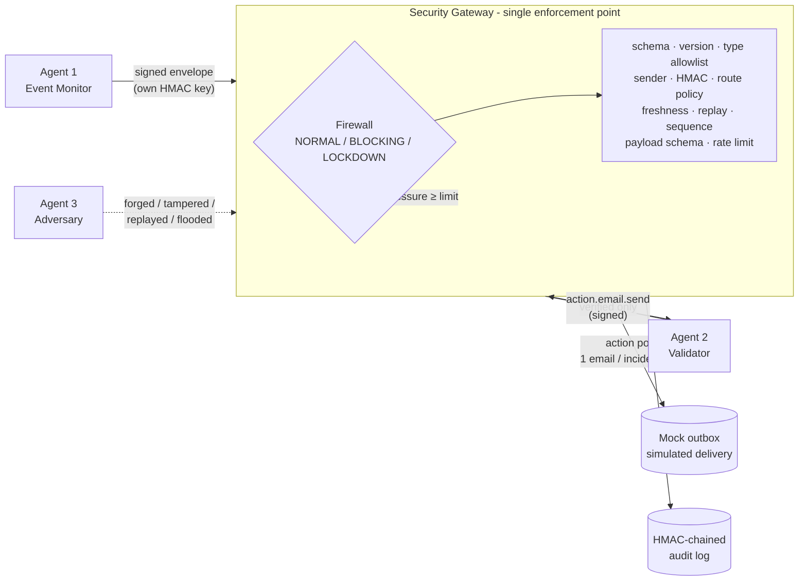

# TripWire: Runtime Defense for Multi-Agent Communication

> AI agents can talk to each other and take actions. What happens when one agent turns malicious, or someone gets onto the channel between them?
> **TripWire puts a policy-enforced gateway between agents.** The gateway authenticates and validates every message, a built-in adversary attacks it continuously, and unsafe actions are stopped at runtime, not just shown as "blocked" on a screen.

Built for **HackInverse 1.0** (Open Innovation, 11 Oct 2026). It is pure Python 3.10+ standard library, so there is nothing to install and no API keys, and it runs fully offline. The tests run on Linux with Python 3.10 and 3.13, and CI also runs them on Windows.


## What it demonstrates

| Agent | Role | Can it bypass the gateway? |
|---|---|---|
| **Agent 1 · Event Monitor** | Scores a simulated security event stream (0-100 heuristic index). Sends an `alert.request` when the score crosses the threshold (default **70**). | No. It can only *produce* signed envelopes. |
| **Agent 2 · Validator** | Re-checks each alert against the server-side threshold. If it passes, it asks the gateway for the protected `action.email.send`. | No. The gateway is the only thing that calls it. |
| **Agent 3 · Adversary** | Runs 10 bounded attack scenarios through **the same `Gateway.submit` path** the real agents use. | No. It isn't even a registered agent. |
| **Gateway + Firewall** | The single enforcement point. It denies anything unknown by default, and has a `NORMAL → BLOCKING → LOCKDOWN` state machine. | — |
| **Mock email action** | Records every attempt: `SIMULATED_DELIVERY`, `BLOCKED` or `REJECTED`. **It never sends real email.** | — |



## Quick start (Windows PowerShell)

```powershell
Set-Location -LiteralPath 'C:\Users\MOUSHIMI\tripwire_in\tripwire_in\trip-wiree'
python --version                 # 3.10 or newer
python -m tripwire serve --open  # opens http://127.0.0.1:8765
```

The terminal prints the **operator recovery code**, which you need to get out of LOCKDOWN. The code is never sent to the browser. To pick a memorable one for a live demo:

```powershell
$env:TRIPWIRE_RECOVERY_CODE = "TW-JUDGE-42"; python -m tripwire serve --open
```

Other commands:

```powershell
python -m tripwire demo          # scripted end-to-end story in the terminal
python -m tripwire attack-demo   # every attack vs. the insecure baseline AND the strict gateway
python -m unittest discover -t . -s tests -v   # 54 tests
```

If port 8765 is busy, use `python -m tripwire serve --port 8800`.

## The 3-minute demo

Click **Run next step** in the dashboard's *Guided demo* panel. The full script with talking points is in [`docs/DEMO.md`](docs/DEMO.md).

1. **Normal traffic.** Baseline events are accepted and no email is sent.
2. **Threshold crossed.** The incident stream climbs 8 → 14 → 24 → 49 → **74**. The alert is validated and exactly **one** simulated email lands in the outbox.
3. **Attack.** Tampering and a forged sender are both rejected with `BAD_MAC`. The outbox doesn't change.
4. **Kill switch.** The firewall goes to BLOCKING. This is backend state, not a UI toggle.
5. **Protected action while blocked.** Agent 1's alert is `BLOCKED` and no email record is written.
6. **Full attack sequence.** Intrusion pressure rises until the gateway puts itself into **automatic LOCKDOWN**.
7. **Audit.** The HMAC chain verifies. Press *Tamper a record* and *Verify* again to see the tampering detected.
8. **Recovery.** Only the operator's code returns the system to NORMAL.

To show **why** this matters, switch the profile to **Baseline (insecure)** and re-run the attacks. Forged, tampered, replayed and privilege-escalated messages then deliver emails, some to `exfil@attacker.invalid`. Same attacks under `attack-demo` (measured output, not estimates):

| Profile | Attack messages | Passed gateway | Unauthorized emails |
|---|---|---|---|
| baseline (checks off) | 34 | 32 | **6** |
| strict (TripWire) | 34 | 10 (in-budget flood only) | **0** |

## Protocol v2 (summary)

Every message is a JSON envelope with an exact field set:

```json
{
  "protocol_version": 2, "message_id": "uuid4", "correlation_id": "inc-…",
  "sender_id": "agent-1-monitor", "receiver_id": "agent-2-validator",
  "message_type": "alert.request", "timestamp": 1791700000.12,
  "nonce": "32 hex", "sequence_number": 7,
  "payload": {"risk_score": 74.06, "threshold": 70, "signals": ["malware_signature"], "summary": "…"},
  "integrity_proof": {"alg": "HMAC-SHA256", "key_id": "agent-1-monitor#a1b2c3d4", "mac": "64 hex"}
}
```

The MAC covers **every field** (including `receiver_id`, `timestamp`, `sequence_number`, `alg` and `key_id`), using a key that belongs to that one agent. Allowed routes:

| message_type | allowed sender | receiver |
|---|---|---|
| `telemetry.report` | agent-1-monitor | agent-2-validator |
| `alert.request` | agent-1-monitor | agent-2-validator |
| `action.email.send` | agent-2-validator | action:email |

Anything else is refused. Every rejection has a stable code: `SCHEMA_INVALID`, `OVERSIZE`, `UNSUPPORTED_VERSION`, `UNKNOWN_MESSAGE_TYPE`, `UNKNOWN_SENDER`, `BAD_MAC`, `UNAUTHORIZED_ROUTE`, `STALE`, `FUTURE_TIMESTAMP`, `REPLAY`, `SEQUENCE_REGRESSION`, `PAYLOAD_INVALID`, `RATE_LIMITED`, `ACTION_DENIED`, `VALIDATOR_REFUSED`, `FIREWALL_BLOCKING` and `FIREWALL_LOCKDOWN`. Details are in [ARCHITECTURE.md](ARCHITECTURE.md).

## Attack scenarios

| Scenario | Threat model | Stopped by |
|---|---|---|
| Malformed & oversized envelope | external | `SCHEMA_INVALID`, `OVERSIZE` |
| Forged sender → email action | external (no key) | `BAD_MAC` |
| Payload tampering in transit | MITM | `BAD_MAC` |
| Replay of captured message | MITM | `REPLAY` |
| Delayed injection (10 min old) | MITM | `STALE` |
| Out-of-order delivery | MITM | `SEQUENCE_REGRESSION` |
| Privilege escalation to email action | compromised Agent 1 key | `UNAUTHORIZED_ROUTE` |
| Recipient injection (`"to": attacker`) | compromised Agent 1 key | `PAYLOAD_INVALID` |
| Message flood (25 msgs) | compromised Agent 1 key | `RATE_LIMITED` after budget |
| Probe while BLOCKING/LOCKDOWN | compromised Agent 1 key | `FIREWALL_*` |

The adversary never opens a socket. It only calls this process's gateway, and each scenario is capped at 30 messages and can be stopped.

## Metrics (all derived from recorded decisions)

- **messages / accepted / rejected / blocked:** every gateway decision, including action requests.
- **attack msgs:** envelopes submitted by Agent 3. **Stopped** means not accepted, or refused by the validator. **Identified by a specific check** means rejected with a protocol code, or blocked when the inspection would also have failed.
- **unauthorized emails:** simulated deliveries caused by an attacker-originated message.
- **decision latency:** in-process gateway evaluation time for rejected attacks (`perf_counter`). This is not network latency.
- The attack/legit labels are *simulation ground truth* used only for metrics. The gateway never sees them, and a test proves the same envelope gets the same decision whichever label it carries.

## Limitations (read before judging)

- **Simulation, not production.** These are application-level controls. No OS firewall rules are changed, agents run in one process, and email is simulated only.
- **Symmetric keys.** HMAC gives integrity and origin authentication *towards the gateway*. It doesn't give non-repudiation or encryption. Keys are random per process and live in memory.
- **Stolen keys.** If an attacker steals Agent 1's key and sends an *in-policy* message, the gateway can't tell it apart from Agent 1. Route policy, strict schemas, rate limits, one-email-per-incident and the firewall limit the damage, but they don't prevent it. That's why the `probe_while_blocked` scenario only runs while the firewall is engaged.
- **In-budget flood messages pass.** They are valid and inside the rate limit, so they're reported honestly as "passed".
- **Replay state lives in memory.** It resets when the server restarts. Messages older than the 30 s freshness window are rejected as `STALE`, so the bounded cache is safe within one run.
- **Audit tamper-evidence** depends on the in-process audit key. Truncating the tail is only detectable by comparing the head hash shown on the dashboard.
- **Risk score** is a deterministic heuristic (`score = min(100, 0.8·prev + weight)`), **not a probability**.
- The local API has no user accounts. It binds to 127.0.0.1, rejects cross-origin and header-less POSTs, and protects recovery with a code and throttling.

## Project layout

```
tripwire/
  protocol.py      envelope v2, canonical JSON, per-agent keys, payload schemas
  gateway.py       default-deny enforcement pipeline, action policy, intrusion pressure
  firewall.py      NORMAL / BLOCKING / LOCKDOWN state machine + authorized recovery
  agents.py        Agent 1 (EventMonitor) and Agent 2 (Validator)
  attacks.py       Agent 3 (Adversary) and the 10 scenarios
  risk.py          deterministic risk model and event streams
  notifications.py mock email service (never sends)
  audit.py         HMAC hash-chained audit log
  session.py       wires everything together; metrics; attack runner
  server.py        stdlib HTTP API + security headers
  dashboard.html   single-file offline console
tests/             54 tests: protocol, workflow, firewall, audit, concurrency, attacks, API
docs/DEMO.md       judge demo script     docs/adr/  architecture decisions
```

See [CONTRIBUTING.md](CONTRIBUTING.md) for the development workflow.
